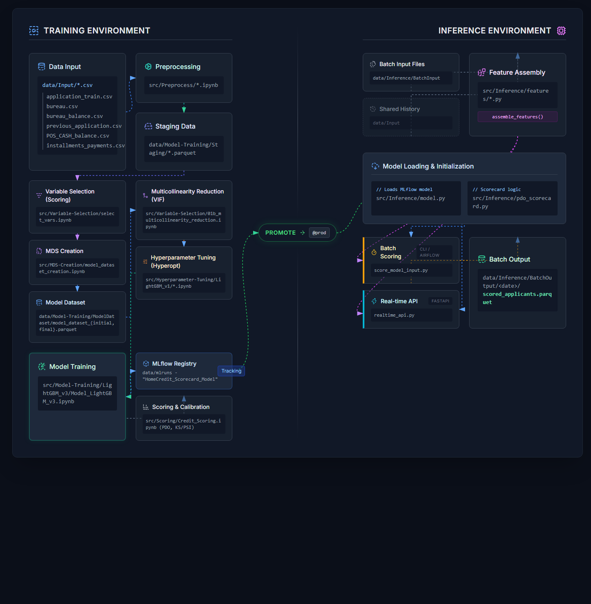

# Home Credit — Architecture & Pipeline Guide

Default-prediction ML system for Home Credit loan applications. This doc covers
the overall architecture and how to run both the **training pipeline**
(feature engineering → dataset → variable selection → hyperparameter tuning →
model training → scorecard) and the **inference pipeline** (batch and
real-time scoring of a trained model).

## 1. High-level architecture



An interactive version of this diagram (clickable components, hover states) is
in [architecture_diagram.html](architecture_diagram.html) — open it directly in
a browser.

```
┌─────────────────────────────────────────────────────────────────────────┐
│                              TRAINING SIDE                              │
│                                                                         │
│  data/Input/*.csv                                                       │
│       │  (application_train.csv, bureau.csv, bureau_balance.csv,        │
│       │   previous_application.csv, POS_CASH_balance.csv,               │
│       │   credit_card_balance.csv, installments_payments.csv)           │
│       ▼                                                                 │
│  src/Preprocess/*.ipynb   ──►  data/Model-Training/Staging/*.parquet    │
│       ▼                                                                 │
│  src/Variable-Selection/select_vars.ipynb (feature scoring)             │
│       ▼                                                                 │
│  src/MDS-Creation/model_dataset_creation.ipynb                          │
│       ▼                                                                 │
│  data/Model-Training/ModelDataset/model_dataset_{initial,final}.parquet │
│       ▼                                                                 │
│  src/Variable-Selection/01b_multicollinearity_reduction.ipynb (VIF)     │
│       ▼                                                                 │
│  src/Hyperparameter-Tuning/LightGBM_v1/*.ipynb  (optional, hyperopt)    │
│       ▼                                                                 │
│  src/Model-Training/LightGBM_v3/Model_LightGBM_v3.ipynb                 │
│       ▼                                                                 │
│  MLflow registry (data/mlruns) — "HomeCredit_Scorecard_Model"           │
│       ▼                                                                 │
│  src/Scoring/Credit_Scoring.ipynb  (PDO scorecard, calibration, KS/PSI) │
└─────────────────────────────────────────────────────────────────────────┘
                                    │
                                    │  model promoted to @prod alias
                                    ▼
┌─────────────────────────────────────────────────────────────────────────┐
│                             INFERENCE SIDE                              │
│                                                                         │
│  src/Inference/features/*.py  ──►  assemble_features()                  │
│       ▲                                    │                            │
│       │                                    ▼                            │
│  data/Input (shared history)      src/Inference/model.py (MLflow load)  │
│  data/Inference/BatchInput        src/Inference/pdo_scorecard.py        │
│       │                                    │                            │
│       ▼                                    ▼                            │
│  score_model_input.py (batch, CLI/Airflow)   realtime_api.py (FastAPI)  │
│       ▼                                                                 │
│  data/Inference/BatchOutput/<date>/scored_applicants.parquet            │
└─────────────────────────────────────────────────────────────────────────┘
```

Orchestration for both sides runs on **Apache Airflow** (standalone mode,
`SequentialExecutor` + SQLite) inside one Docker container defined by
[`Dockerfile`](Dockerfile) and wired up by [`docker-compose.yml`](docker-compose.yml).
A second container runs the **MLflow UI** against the same file-based
tracking store (`data/mlruns`).

## 2. Directory layout

```
data/
  Input/                        Raw Kaggle CSVs + shared credit-history CSVs (also read by inference)
  mlruns/                       MLflow file-store (tracking + model registry)
  Model-Training/
    Staging/                    Per-table processed parquets (Preprocess notebooks output)
    ModelDataset/                model_dataset_initial.parquet, model_dataset_final.parquet
    Variable-Selection/          VIF/multicollinearity outputs
    HyperParameters/             Hyperopt trial results
    ModelOutput/<model_folder>/  Trained model artifacts, executed notebooks
    ScoreOutput/                 Credit_Scoring.ipynb outputs
    notebook_outputs/            Executed (papermill) copies of every DAG-run notebook, for audit
  Inference/
    BatchInput/<date>/            application.csv for that batch (date-partitioned)
    BatchFeatures/<date>/         Per-table feature parquets + joined feature_matrix.parquet
    BatchOutput/<date>/           scored_applicants.parquet, band_summary.csv

src/
  Preprocess/                   Application_data, Bureau_data, CreditCard_data, POS_data,
                                 Payment_installments_data, Prevloans_data (.ipynb)
  Variable-Selection/           select_vars.ipynb, 01b_multicollinearity_reduction.ipynb, corr_clustering.ipynb
  MDS-Creation/                 model_dataset_creation.ipynb
  Hyperparameter-Tuning/        LightGBM_v1/LightGBM_hyperpars_tuning.ipynb
  Model-Training/               LightGBM_v1..v4/, XGB_v1/ (Model_LightGBM_vN.ipynb)
  Scoring/                      Credit_Scoring.ipynb (PDO scorecard, calibration, KS, PSI)
  Inference/                    Production-facing Python package (see §5)

dags/                           Airflow DAG definitions (live-synced into the container)
scripts/entrypoint.sh           Container startup: creates dirs, inits Airflow DB, starts standalone
Dockerfile, docker-compose.yml  Container build/run definition
```

`data/Input` and `data/mlruns` are deliberately kept at the top level of
`data/` — they're shared between the training and inference sides.
Everything else training-related lives under `data/Model-Training/`.

## 3. Orchestration (Airflow DAGs)

All DAGs live in [`dags/`](dags/) — the only directory `docker-compose.yml`
live-syncs into Airflow's DAG folder (`./dags:/opt/airflow/dags`), so edits
there are picked up without a rebuild. Each DAG resolves `HOMECREDIT_DATA_ROOT`
(`/data`) and `HOMECREDIT_SRC_DIR` (`/src`) from environment variables set in
`docker-compose.yml`.

DAGs are numbered in pipeline order instead of sharing a `homecredit_`
prefix, so the run order is visible directly in the Airflow DAGs list.

| DAG id | File | Purpose |
|---|---|---|
| `01_preprocessing` | [01_preprocessing_dag.py](dags/01_preprocessing_dag.py) | Runs the 6 Preprocess notebooks via papermill, one task per raw table, in parallel where there's no dependency. By default, triggers `02_variable_selection` once all tasks succeed — set the `trigger_variable_selection` param to `false` to stop after preprocessing. |
| `02_variable_selection` | [02_variable_selection_dag.py](dags/02_variable_selection_dag.py) | Runs `select_vars.ipynb`. Split out of `01_preprocessing` (was that DAG's `task_select_vars`) so it can be retried/skipped independently. By default, triggers `03_mds_creation_and_multicollinearity_test` once it finishes — set the `trigger_mds_creation` param to `false` to stop after variable selection. |
| `03_mds_creation_and_multicollinearity_test` | [03_mds_creation_and_multicollinearity_test_dag.py](dags/03_mds_creation_and_multicollinearity_test_dag.py) | Runs `model_dataset_creation.ipynb`, then `01b_multicollinearity_reduction.ipynb` (VIF-based feature pruning — previously a manual step run outside any DAG); branches to hyperparameter tuning or straight to training based on a UI toggle (`run_hyperopt`). |
| `04_hyperparameter_tuning` | [04_hyperparameter_tuning_dag.py](dags/04_hyperparameter_tuning_dag.py) | Runs a tuning notebook chosen via `model_folder`/`notebook_name` params (default: `LightGBM_v1/LightGBM_hyperpars_tuning.ipynb`); branches to training based on a UI toggle (`trigger_training`). |
| `05_model_training` | [05_model_training_dag.py](dags/05_model_training_dag.py) | Runs a training notebook chosen via `model_folder`/`notebook_name` params (default: `LightGBM_v1/Model_LightGBM.ipynb` — see note below). |
| `home_credit_batch_inference` | [inference_batch_dag.py](dags/inference_batch_dag.py) | Batch-scores a dated applicant file: one task per raw table → join → score. |

All five numbered training DAGs execute notebooks via
`papermill.execute_notebook()` (each notebook self-configures from env vars
— no parameters are injected) and save the executed copy to
`data/Model-Training/notebook_outputs/` for audit/debugging.

`04_hyperparameter_tuning` and `05_model_training` don't hardcode a
model family — each takes `model_folder` (subfolder under
`src/Hyperparameter-Tuning/` or `src/Model-Training/`) and `notebook_name`
as DAG run params, so tuning/training a different model version is a param
change on the trigger screen (or `--conf`), not a DAG edit. When
`04_hyperparameter_tuning` triggers training afterward, it forwards its own
`model_folder` to `05_model_training` automatically (via
`TriggerDagRunOperator(conf=...)`), so the model you just tuned is the one
that gets trained — but not `notebook_name`, since a model's tuning and
training notebooks are usually named differently; override it on the
training trigger screen if the default (`Model_LightGBM.ipynb`) is wrong
for that folder.

**Note:** `05_model_training`'s *default* params still point at
`src/Model-Training/LightGBM_v1/Model_LightGBM.ipynb`, but the model
actually registered to MLflow and referenced by the inference side
(`config.SELECTED_FEATURES_PATH`, `verify_feature_parity.py`) is
**LightGBM_v3**. To train the production model via this DAG, trigger it
with `model_folder=LightGBM_v3`, `notebook_name=Model_LightGBM_v3.ipynb`
(see §6.4) rather than accepting the defaults.

### DAG dependency chain (Preprocessing)

```
application_train.csv ──► task_application    ──┐
                                                │
previous_application.csv ► task_prevloans     ──┼──► task_pos
                                                ├──► task_creditcard
                                                └──► task_installments
bureau.csv              ┌─► task_bureau ────────────────┐
bureau_balance.csv  ────┘                               │
(all above) ──────────────────────────────────────► branch_task
                                                          │
                                trigger_variable_selection param (default true)
                                     ┌true───────────false┐
                                     ▼                    ▼
                     trigger 02_variable_selection   skip_variable_selection
                                     │
                                     ▼
                          select_vars (02_variable_selection DAG)
                                     │
                       trigger_mds_creation param (default true)
                                     ┌true───────────false┐
                                     ▼                    ▼
     trigger 03_mds_creation_and_multicollinearity_test   skip_mds_creation
                                     │
                                     ▼
                  create_mds ──► multicollinearity_reduction ──► branch_task
                     (03_mds_creation_and_multicollinearity_test DAG)
                                     │
                          run_hyperopt param (default false)
                                     ┌true───────────false┐
                                     ▼                    ▼
                trigger 04_hyperparameter_tuning   trigger 05_model_training
```

### DAG chain (Batch Inference)

```
wait_for_raw_data (PythonSensor, polls for application.csv)
  ─► [build_application_features, build_bureau_features,
      build_previous_application_features, build_pos_cash_features,
      build_installments_features]   (parallel)
  ─► join_features   (merges the 5 parquets into feature_matrix.parquet)
  ─► score_features   (scores + writes scored_applicants.parquet, band_summary.csv)
```

`wait_for_raw_data` uses a `PythonSensor` (plain `Path.exists()` check), not
`FileSensor` — `FileSensor` requires an Airflow `fs_default` Connection that
isn't auto-created under Airflow 3.x's `airflow db migrate`.

## 4. Training pipeline — what each stage does

1. **Preprocess** (`src/Preprocess/*.ipynb`) — one notebook per raw table.
   Cleans sentinel values (e.g. `365243`, `XNA`), engineers ratios/flags, and
   aggregates history tables (Bureau, POS, CreditCard, Payment_installments)
   into rolling time windows (`_LAST3M/6M/1Y/2Y/3Y`) plus recent-vs-historical
   ratio features (`_LAST6M_TO_3Y_RATIO`, via `add_period_ratio_features()`
   in `CreditCard_data.ipynb`, reused in `POS_data.ipynb` and
   `Payment_installments_data.ipynb`). Output: one processed parquet per
   table in `data/Model-Training/Staging/`.
2. **Variable selection (first pass)** (`select_vars.ipynb`, run by its own
   `02_variable_selection` DAG, triggered by `01_preprocessing` by default) —
   computes per-feature AUC, t-test, Cohen's d, univariate logistic
   coefficient, VIF, and target correlation across all staged parquets;
   writes a scored Excel.
3. **MDS creation** (`model_dataset_creation.ipynb`, run by the
   `03_mds_creation_and_multicollinearity_test` DAG) — joins every processed
   parquet under `Staging/` on `SK_ID_CURR`, downcasts dtypes, and writes
   `model_dataset_initial.parquet`.
4. **Multicollinearity reduction** (`01b_multicollinearity_reduction.ipynb`,
   same DAG, runs right after MDS creation) — VIF-based feature pruning
   against `model_dataset_initial.parquet`, protecting features with strong
   predictive scores from step 2's output; writes `model_dataset_final.parquet`
   (initial file is left untouched).
5. **Hyperparameter tuning** (optional) — `LightGBM_hyperpars_tuning.ipynb`
   reads `model_dataset_final.parquet`, runs `hyperopt` search, writes best
   params to `data/Model-Training/HyperParameters/`.
6. **Model training** — `Model_LightGBM_v3.ipynb` trains a
   `lgb.LGBMClassifier` (GOSS boosting) on `model_dataset_final.parquet`
   using the tuned (or default) hyperparameters, wraps it as
   `LightGBMProductionWrapper`, and registers it to the MLflow model
   registry under `HomeCredit_Scorecard_Model`. **Promotion to the `prod`
   alias is a manual step** — done in the MLflow UI after reviewing the run
   (MLflow uses aliases, not the deprecated stage system).
7. **Scoring/scorecard** — `Credit_Scoring.ipynb` converts predicted
   probability of default to a PDO (Points-to-Double-the-Odds) credit score
   and A–E risk band, and produces calibration curves, KS statistic, and PSI
   (population stability index) diagnostics.

## 5. Inference pipeline — architecture

Everything production-facing lives in `src/Inference/`:

| File | Role |
|---|---|
| `config.py` | Central config — data paths, MLflow URI/model name/alias, PDO constants, risk-band thresholds. Pinned to match `Model_LightGBM_v3.ipynb` / `Credit_Scoring.ipynb`; keep in sync manually if those change. |
| `features/pipeline.py` | `assemble_features(raw_tables)` — the **one place** raw CSVs become the model's feature matrix. Calls each table's `features/<table>.py::build_features()`, then `merge_feature_frames()` (join on `SK_ID_CURR`, validate against `selected_features.xlsx`, downcast dtypes to match training). Used by batch, real-time, and the Airflow per-table tasks alike, so all three paths can't silently diverge. |
| `features/application.py`, `bureau.py`, `previous_application.py`, `pos_cash.py`, `installments.py` | Per-table feature engineering, mirroring the Preprocess notebooks' logic. `credit_card.py` exists as a TODO stub (not currently wired into `assemble_features`). |
| `model.py` | `load_model()` (cached MLflow pyfunc load via `models:/{name}@{alias}`), `predict_proba(feature_df)`. |
| `pdo_scorecard.py` | `proba_to_score()`, `score_to_risk_band()` — same PDO/band logic as `Credit_Scoring.ipynb`. |
| `score_model_input.py` | Shared `score_applicants(feature_df)` (also called by `realtime_api.py`) + a CLI (`main(application_date)`) that loads raw tables, assembles features, scores, and writes batch output. Runs identically standalone or from Airflow. |
| `realtime_api.py` | FastAPI app (`POST /score`) for single-applicant scoring — validates via `schemas.py`, calls `assemble_features` + `score_applicants`. |
| `schemas.py` | Pydantic `ApplicationRequest` / `ScoreResponse` models for the API. |
| `batch_feature_tasks.py` | Per-table Airflow task callables used by `dags/inference_batch_dag.py` — same feature logic as `score_model_input.py`, split into one task per table + `join_features` + `score_features`, writing intermediate parquets to `data/Inference/BatchFeatures/<date>/`. |
| `verify_feature_parity.py` | Compares `assemble_features()` output against the training ground truth (`model_dataset_final.parquet`) — structural (feature list) and value-level (row match rate) checks. |
| `Batch_Inference.ipynb` | Notebook version of batch scoring, for interactive/manual runs; reuses `score_model_input.load_raw_tables()`. |

Batch and real-time scoring both funnel through the same
`assemble_features()` → `score_applicants()` call chain, so they can't
silently compute different results for the same applicant.

## 6. Running it

### 6.1 Build and start the containers

```bash
# Build + start both containers (pipeline + mlflow), rebuilding the image
docker compose up --build

# Same, but detached (returns control of the terminal)
docker compose up --build -d

# Build the image without starting anything (e.g. to check the build succeeds)
docker build -t homecredit-pipeline:latest .

# Point at a different local data/src directory instead of ./data, ./src
DATA_PATH=/your/path SRC_PATH=/your/src docker compose up --build
```

This starts:
- `homecredit_pipeline` — Airflow standalone (webserver + scheduler +
  triggerer) at **http://localhost:8080** (login `admin` / `admin`).
- `homecredit_mlflow` — MLflow UI at **http://localhost:5000**, pointed at
  `data/mlruns`.

If port 8080 is already in use on Windows, a common culprit is another local
service (e.g. MTAgentService) bound to it — stop that service or change the
host port mapping in `docker-compose.yml`.

Other useful compose commands:

```bash
# Tail logs from both containers (Ctrl+C to stop watching, containers keep running)
docker compose logs -f

# Tail logs from just one service
docker compose logs -f pipeline
docker compose logs -f mlflow

# Check container status
docker compose ps

# Stop the containers (keeps the airflow_db volume + your data/ and src/ bind mounts)
docker compose down

# Stop and also remove the named volumes (Airflow's SQLite DB, notebook_outputs, mlruns)
docker compose down -v

# Restart just one service without rebuilding
docker compose restart pipeline
```

### 6.2 Open the UIs

Both UIs are plain web pages served by the running containers — there's no
separate "open" command, just point a browser at the URL once
`docker compose up` is running:

- **Airflow UI**: http://localhost:8080 (login `admin` / `admin`)
- **MLflow UI**: http://localhost:5000

To open them straight from the terminal on Windows:

```powershell
# PowerShell
Start-Process "http://localhost:8080"
Start-Process "http://localhost:5000"
```

```cmd
:: cmd.exe
start http://localhost:8080
start http://localhost:5000
```

### 6.3 Drive Airflow from the CLI (alternative to the UI)

Everything you can do by clicking around the Airflow UI can also be run via
`airflow` CLI commands inside the running `homecredit_pipeline` container —
useful for scripting a run or checking status without a browser:

```bash
# Open a shell inside the running container
docker compose exec pipeline bash

# ...or run a single airflow command directly without an interactive shell
docker compose exec pipeline airflow dags list

# List all DAGs and whether they're paused
docker compose exec pipeline airflow dags list

# Un-pause a DAG (new DAGs can start paused depending on config)
docker compose exec pipeline airflow dags unpause 01_preprocessing

# Trigger a DAG run right now
docker compose exec pipeline airflow dags trigger 01_preprocessing

# Trigger with a config param (e.g. batch inference for a specific date)
docker compose exec pipeline airflow dags trigger home_credit_batch_inference \
  --conf '{"application_date": "2026-09-04"}'

# Trigger the create-mds DAG with hyperopt enabled
docker compose exec pipeline airflow dags trigger 03_mds_creation_and_multicollinearity_test \
  --conf '{"run_hyperopt": true}'

# List recent runs of a DAG and their state
docker compose exec pipeline airflow dags list-runs -d 01_preprocessing

# List task states for a specific run
docker compose exec pipeline airflow tasks states-for-dag-run \
  01_preprocessing <run_id>

# Tail a specific task's logs
docker compose exec pipeline airflow tasks logs 01_preprocessing \
  task_application <run_id>

# Re-run a specific task (e.g. after fixing a bug) by clearing its state
docker compose exec pipeline airflow tasks clear 01_preprocessing \
  -t task_application -s <run_id> -e <run_id>
```

(`docker compose exec` requires the containers to already be running via
`docker compose up`; use `docker compose run --rm pipeline airflow ...`
instead if you want a one-off command without the stack already up.)

### 6.4 Run the training pipeline

Via the Airflow UI (`localhost:8080`) or the equivalent `airflow dags
trigger` commands from §6.3:

1. **Trigger `01_preprocessing`** — runs all Preprocess notebooks. Outputs
   land in `data/Model-Training/Staging/`. By default, once all tasks
   succeed it automatically triggers `02_variable_selection`; pass
   `--conf '{"trigger_variable_selection": false}'` (or uncheck the param
   on the trigger screen) to stop after preprocessing instead.
   ```bash
   docker compose exec pipeline airflow dags trigger 01_preprocessing
   ```
2. **`02_variable_selection`** — runs `select_vars.ipynb`, scoring every
   engineered feature and writing `numeric_selection_metrics_full_df.xlsx`.
   Triggered automatically by step 1 unless disabled; can also be run
   standalone:
   ```bash
   docker compose exec pipeline airflow dags trigger 02_variable_selection
   ```
   By default, once it finishes it automatically triggers
   `03_mds_creation_and_multicollinearity_test` in turn; pass
   `--conf '{"trigger_mds_creation": false}'` (or uncheck the param on the
   trigger screen) to stop after variable selection instead.
3. **Trigger `03_mds_creation_and_multicollinearity_test`** — runs
   `model_dataset_creation.ipynb`, then `01b_multicollinearity_reduction.ipynb`
   (VIF-based feature pruning against `model_dataset_initial.parquet`,
   protecting features with strong predictive scores from step 2's output;
   writes `model_dataset_final.parquet`). Set the `run_hyperopt` param
   (checkbox on the trigger screen, or `--conf '{"run_hyperopt": true}'` on
   the CLI) if you want it to auto-continue into hyperparameter tuning;
   otherwise it triggers `05_model_training` directly.
4. *(Optional)* **`04_hyperparameter_tuning`** — runs the tuning notebook
   named by `model_folder`/`notebook_name` (default:
   `LightGBM_v1/LightGBM_hyperpars_tuning.ipynb`); toggle `trigger_training`
   (or `--conf '{"trigger_training": true}'`) to chain into training
   automatically, which also forwards `model_folder` to the training DAG.
   Toggle `use_previous_best` (or `--conf '{"use_previous_best": true}'`) to
   map onto the notebook's `USE_PREVIOUS_BEST` flag — `true` skips the live
   Hyperopt search and loads the previously-saved `lgbm_resolved_best.json`
   instead; `false` (default) runs the full live search. The DAG sets this
   via a `HOMECREDIT_USE_PREVIOUS_BEST` env var before calling
   `papermill.execute_notebook()` — the same self-configuration pattern as
   `HOMECREDIT_DATA_ROOT`/`HOMECREDIT_SRC_DIR`, not papermill's `parameters=`
   injection — so it only takes effect for notebooks that actually read
   `HOMECREDIT_USE_PREVIOUS_BEST` (currently just LightGBM_v1's tuning
   notebook); it's a harmless unused env var for any other.
   ```bash
   docker compose exec pipeline airflow dags trigger 04_hyperparameter_tuning \
     --conf '{"model_folder": "LightGBM_v1", "notebook_name": "LightGBM_hyperpars_tuning.ipynb", "trigger_training": true, "use_previous_best": false}'
   ```
5. **`05_model_training`** — trains and registers the model to
   MLflow. Runs the notebook named by `model_folder`/`notebook_name`
   (default: `LightGBM_v1/Model_LightGBM.ipynb`). **To train the current
   production model, override the defaults to point at LightGBM_v3**:
   ```bash
   docker compose exec pipeline airflow dags trigger 05_model_training \
     --conf '{"model_folder": "LightGBM_v3", "notebook_name": "Model_LightGBM_v3.ipynb"}'
   ```
   or set `model_folder`/`notebook_name` on the trigger screen in the UI.
7. **Promote the model** — in the MLflow UI (`localhost:5000`), open
   `HomeCredit_Scorecard_Model`, pick the version you want to serve, and
   assign it the **`prod`** alias. Inference always loads
   `models:/HomeCredit_Scorecard_Model@prod`.

   This step has no CLI equivalent worth using here — MLflow does have a
   `mlflow models set-alias` command, but it targets a server-backed
   registry endpoint; with this project's file-store tracking URI
   (`file:///data/mlruns`), assigning the alias in the UI is the reliable
   path, not a scripting gap.
8. *(Optional)* Run `Credit_Scoring.ipynb` manually to generate the PDO
   scorecard, calibration curves, KS, and PSI diagnostics.

You can also run any of these notebooks directly (outside Airflow/Docker) as
long as `HOMECREDIT_DATA_ROOT` / `HOMECREDIT_SRC_DIR` point at the right
paths — each notebook self-configures from those env vars. From a local
Python environment (e.g. `project_env`):

```powershell
# PowerShell: activate the local venv, then open Jupyter to run notebooks interactively
project_env\Scripts\Activate.ps1
jupyter notebook src\Preprocess\Application_data.ipynb

# Or execute a notebook headlessly with papermill, same as the DAGs do
papermill src\Preprocess\Application_data.ipynb `
  data\Model-Training\notebook_outputs\application__manual.ipynb
```

### 6.5 Run batch inference

Prerequisites: a model version has the `prod` alias assigned, and
`src/Inference/selected_features.xlsx` (or `src/Model-Training/LightGBM_v3/selected_features.xlsx`,
per `config.SELECTED_FEATURES_PATH`) exists.

**Data layout expected** (per application date, e.g. `2026-09-04`):
- `data/Inference/BatchInput/<date>/application.csv` — the new applicant
  batch (date-partitioned).
- `data/Input/{bureau,previous_application,POS_CASH_balance,installments_payments}.csv`
  — shared credit history, static (not date-partitioned).

**Option A — command line / cron:**
```powershell
# PowerShell, from a local environment (e.g. project_env activated)
project_env\Scripts\Activate.ps1
python src\Inference\score_model_input.py --application-date 2026-09-04
```
```bash
# Or from inside the running container
docker compose exec pipeline python /src/Inference/score_model_input.py --application-date 2026-09-04
```

**Option B — Airflow:** trigger `home_credit_batch_inference` in the UI, or
from the CLI:
```bash
docker compose exec pipeline airflow dags trigger home_credit_batch_inference \
  --conf '{"application_date": "2026-09-04"}'
```
Leave the `application_date` param/`--conf` blank to use the DAG run's
scheduled date, or set it explicitly to score an arbitrary past/ad-hoc batch.

**Option C — notebook:** run `src/Inference/Batch_Inference.ipynb`
interactively.

Output for all three: `data/Inference/BatchOutput/<date>/scored_applicants.parquet`
and `band_summary.csv` (applicant count / mean score / mean PD per risk band).

### 6.6 Run real-time scoring

```bash
cd src/Inference
pip install -r requirements.txt   # first time only — fastapi, uvicorn, pydantic, etc.
uvicorn realtime_api:app --host 0.0.0.0 --port 8000

# Or with auto-reload while developing:
uvicorn realtime_api:app --host 0.0.0.0 --port 8000 --reload
```

The model loads once at startup (`@app.on_event("startup")`) and is cached
in-process — no MLflow round trip per request.

```bash
curl -X POST http://localhost:8000/score \
  -H "Content-Type: application/json" \
  -d '{ "SK_ID_CURR": 100001, ... }'   # see schemas.ApplicationRequest for the full field list

# Health check
curl http://localhost:8000/health
```

Returns `{ SK_ID_CURR, PROBA_DEFAULT, CREDIT_SCORE, RISK_BAND }`. A 422 means
required features were missing/unassemblable for that request; check the
server log for which ones.

### 6.7 Verify feature parity (training vs. inference)

Before trusting inference output, confirm `assemble_features()` reproduces
the same feature values the model was trained on:

```bash
python src/Inference/verify_feature_parity.py
```

Compares against `data/Model-Training/ModelDataset/model_dataset_final.parquet`
structurally (does the feature list match) and at the value level (row-by-row
match rate on a sample of known applicants).

### 6.8 Run the inference test suite

```bash
cd src/Inference
pip install -r requirements.txt
pytest
```

`test_inference_smoke.py` checks the plumbing (join logic, feature-contract
enforcement, PDO math, A–E band edges) without needing a real MLflow model
or real data. `test_history_store.py` currently fails on import — it
exercises a `history_store` module that doesn't exist in this package yet
(see §7).

## 7. Known gaps / manual steps

- **Model promotion is manual**: nothing auto-assigns the `prod` alias after
  training — do it in the MLflow UI after reviewing the run's metrics.
- **`04_hyperparameter_tuning`/`05_model_training`'s default params
  still point at `LightGBM_v1`**, not the production `LightGBM_v3` model —
  the DAGs are parameterized (`model_folder`/`notebook_name`), so this is a
  one-time default worth updating rather than a hardcoded limitation; until
  then, remember to override the params (see §6.4) when training the
  production model.
- **`credit_card.py` feature module is a TODO stub** — credit card features
  are not currently included in `assemble_features()`'s output, even though
  `CreditCard_data.ipynb` produces them for training. If the model's
  selected-feature list includes `CREDITCARD_*` columns, inference will fail
  the missing-features check in `merge_feature_frames()` until this is
  filled in.
- **`.env`-based config** (instead of hardcoded default paths in `config.py`
  / notebooks) has been discussed but not implemented — paths currently
  resolve via `HOMECREDIT_DATA_ROOT` / `HOMECREDIT_SRC_DIR` env vars with a
  hardcoded local Windows path as the fallback default.
