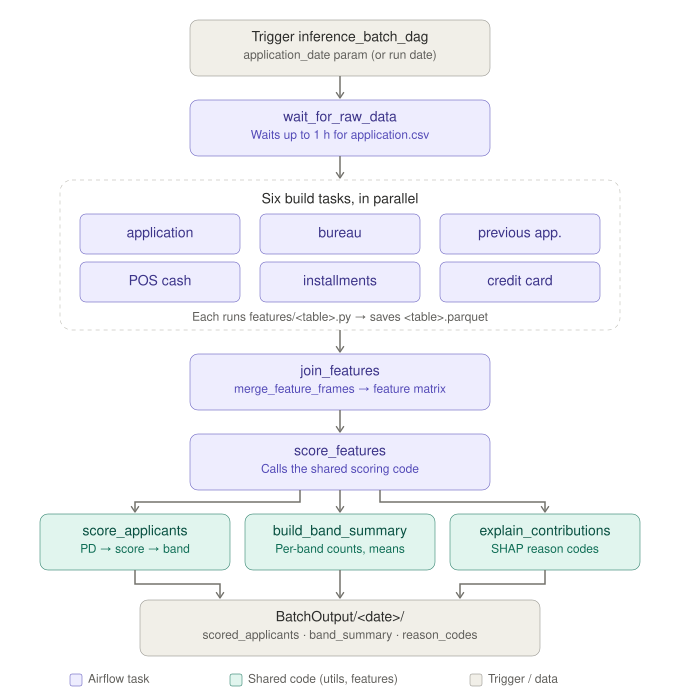
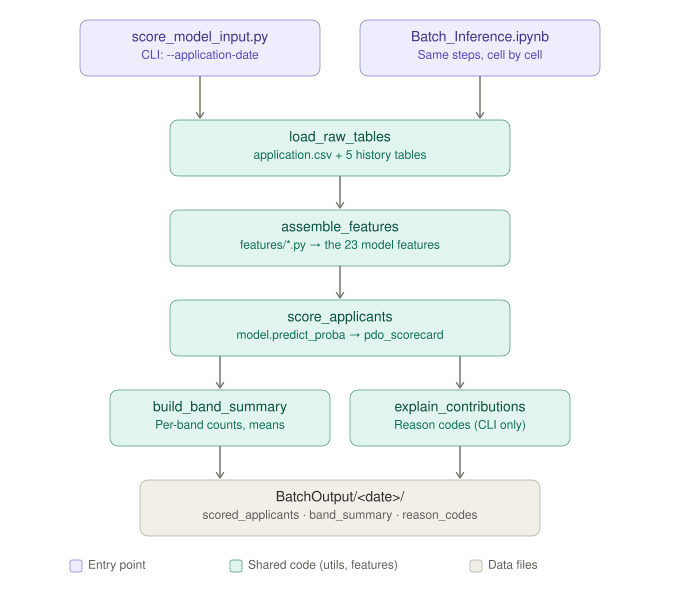
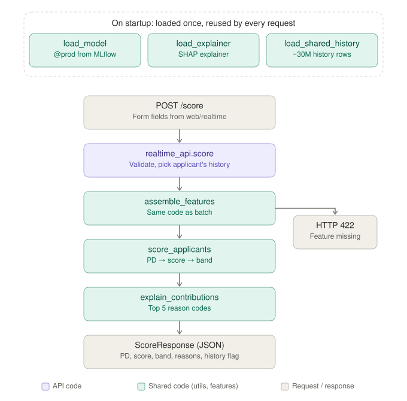
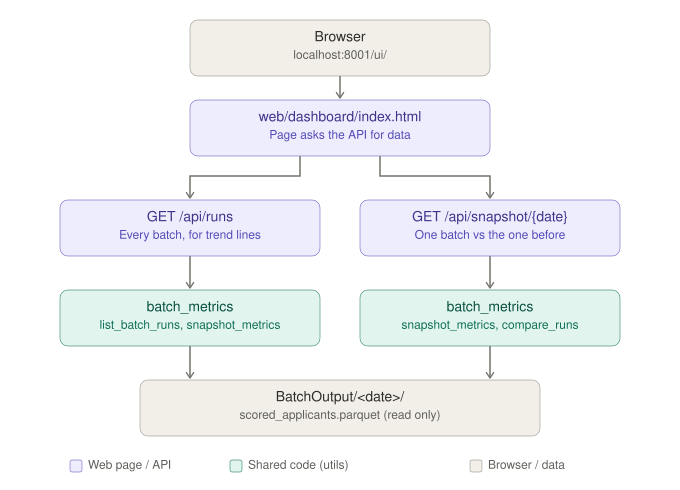

# Home Credit Default — Inference Pipeline

## Design goal

One shared feature/scoring path, two entrypoints:

```
                  ┌─────────────────────────┐
                  │      src/Inference      │
                  │  score_model_input.py   │  <- score_applicants()
                  │  utils/model.py         │  <- MLflow load + predict_proba()
                  │  utils/pdo_scorecard.py │  <- PDO transform (ports pd_to_score)
                  │  utils/explainability.py│  <- SHAP-based points per attribute
                  │  features/pipeline.py   │  <- assemble_features()
                  └───────────┬─────────────┘
                  ┌───────────┴─────────────────────────┐
    score_model_input.py --application-date        realtime_api.py
    (run manually or by Airflow)                        │
                  │                            POST /score (1 applicant)
          Batch_Inference.ipynb
        (interactive wrapper, same import)
```

Both call `score_model_input.score_applicants()`, which returns a
DataFrame with columns `SK_ID_CURR`, `PROBA_DEFAULT`, `score`, `Risk_Band`
— the last two named to match `Credit_Scoring.ipynb` so this output can
be concatenated directly with your scorecard analysis if useful.

The Airflow DAG (`dags/inference_batch_dag.py`) doesn't run
`score_model_input.py`: it runs the same steps as separate tasks from
`utils/batch_feature_tasks.py`, which uses the same `score_applicants()`.
`Batch_Inference.ipynb` is for interactive runs and imports the same
functions, so it can't drift from the other paths.

## Folder layout

The top level holds only the things you run or open; everything they
import lives in `utils/` (imported as `from utils import config`, etc.).

```
src/Inference/
├── score_model_input.py    batch scoring in one go (CLI), and score_applicants()
├── Batch_Inference.ipynb   batch scoring step by step, interactively
├── realtime_api.py         real-time API (port 8000)
├── batch_dashboard_api.py  batch dashboard (port 8001)
├── verify_feature_parity.py  check inference features match training
├── selected_features.xlsx  the @prod model's feature list
├── requirements.txt
├── features/               raw tables -> model features (one module per source table + pipeline.py)
├── utils/                  supporting code (never run directly)
│   ├── config.py               settings: MLflow address, @prod alias, paths, score/band parameters
│   ├── model.py                load @prod from MLflow, predict PD
│   ├── pdo_scorecard.py        PD -> credit score -> risk band
│   ├── explainability.py       SHAP -> points per feature (reason codes)
│   ├── batch_feature_tasks.py  the Airflow batch DAG's task functions
│   ├── schemas.py              the real-time API's request/response format
│   └── batch_metrics.py        the batch dashboard's numbers
├── web/
│   ├── realtime/index.html   the real-time scoring form (http://localhost:8000/ui/)
│   └── dashboard/index.html  the batch dashboard (http://localhost:8001/ui/)
├── docs/                   flow diagrams (SVG) shown in this README
└── tests/                  pytest tests (run `pytest tests` from src/Inference)
```

## Flow of control, by use case

Which function calls which, and which files each way of running inference
reads and writes. Colour key: **purple** = entry point (Airflow task,
script, notebook, API endpoint), **teal** = shared code in `utils/` and
`features/`, **grey** = data, requests and outputs. The diagrams are SVG
files in `docs/` (they show in GitHub, VS Code's preview, or any browser).

The three scoring routes share one core —
`build_features()` per table → `merge_feature_frames()` →
`score_applicants()` → `explain_contributions()`. The CLI, notebook and
real-time API reach the first two through `assemble_features()`, which
calls both; the Airflow DAG calls them directly, one task per table, so
each table runs in parallel and shows up separately in the Airflow UI.
The feature code is the same either way, but the wiring between the steps
exists twice (in `features/pipeline.py` and in
`utils/batch_feature_tasks.py`), so a new table or a changed call has to
be updated in both. One small difference today: if
`previous_application.csv` is missing, `assemble_features()` leaves the
POS cash features blank, while Airflow's POS cash task fails.

### 1. Batch scoring through Airflow (the main route)



The six boxes in the dashed frame are the parallel build tasks,
`build_<table>_features`; each runs that table's `features/<table>.py`
`build_features()` and saves `BatchFeatures/<date>/<table>.parquet`.
`score_applicants` and `explain_contributions` load the `@prod` model
from the MLflow server, which keeps it in `data/mlflow.db` (which version
holds the alias) and `data/mlruns/` (the model files).
The history-table tasks (bureau, previous applications, POS cash,
installments, credit card) read their full CSV from `data/Input/` and keep
only the rows for applicants in this batch's `application.csv`. Tasks hand
data to each other through the parquet files, not in memory. The three
teal steps all run inside the single `score_features` task.

### 2. Batch scoring from the command line or the notebook



One Python process, no intermediate files. All five history tables are in
memory at once, so this route needs more memory than Airflow's, where each
task holds one table. The notebook skips the reason codes and writes only
the first two files.

### 3. Real-time API (one applicant)



After startup, a request reads no files. An `SK_ID_CURR` with no history
rows still scores, with blank history features. A field that fails
`ApplicationRequest`'s checks gets FastAPI's automatic validation error
before `realtime_api.score()` runs.

### 4. Batch monitoring dashboard



The dashboard never loads the model or contacts MLflow, so it keeps
working when MLflow is down. "The batch before it" means the previous
dated folder, not the previous calendar day.

`verify_feature_parity.py` (the developer check) is not drawn: it runs
`assemble_features()` on the training data and compares the result with
`model_dataset_final.parquet` feature by feature, without scoring anyone.

## What's already pinned to your notebooks

- **Model**: loads `models:/HomeCredit_Scorecard_Model@prod` — alias-based,
  matching the manual "assign the prod alias in the MLflow UI" step at the
  end of whichever `02_training_LightGBM_vN.ipynb` is currently promoted
  (`02_training_LightGBM_v4.ipynb`, MLflow version 23, as of the last
  promotion on 2026-11-15). The model is loaded
  through the docker-compose `mlflow` tracking server (`MLFLOW_TRACKING_URI`
  in `utils/config.py`, default `http://localhost:5000`; use
  `http://mlflow:5000` from inside a compose container). The server keeps
  metadata in SQLite (`DATA_ROOT/mlflow.db`, migrated from the old file
  store via `scripts/migrate_mlflow_to_sqlite.py`) and serves the model
  files itself, so inference needs network access to the server, not
  filesystem access to `DATA_ROOT`. Start it with
  `docker compose up -d mlflow`. Versions registered before 2026-10-14
  (1–11, not the current `@prod`) still point at `file:///data/mlruns/...`
  and load only where `/data` exists (see the top-level `README.md`'s
  "Known gaps").

- **Feature list**: read directly from `selected_features.xlsx` (`feature`
  column) at the path `config.SELECTED_FEATURES_PATH` points to
  (`src/Inference/selected_features.xlsx` by default). This is a copy of
  the `feature` column in the currently-promoted model's
  `feature_importance_combined.xlsx`, `summary` sheet
  (`data/Model-Training/ModelOutput/<model_folder>/`) — re-copy it
  whenever a new model is promoted to `@prod`, and rebuild
  `src/Inference/features/*.py` to match if the new model's feature list
  pulls from a raw table or aggregation window the current modules don't
  produce.

- **PDO transform**: `utils/pdo_scorecard.py` is a direct port of `pd_to_score` from
  `Credit_Scoring.ipynb` — same epsilon, same int rounding, same
  `[300, 850]` clip.

- **Risk bands**: same A–E scheme, same fixed cutoffs (560/590/620/650),
  same `right=False` binning as `Credit_Scoring.ipynb` section 5.

- **Model's `predict()` output**: `LightGBMProductionWrapper` always
  returns a plain list of `P(default)`, one per row — `utils/model.py` relies on
  that directly rather than guessing at output shape.

- **Categorical columns**: the wrapper re-casts its stored
  `categorical_features` to `category` dtype internally on every call, so
  nothing extra is needed here — just get the right column names/values in.

- **`src/Inference/features/*.py`** (`application.py`, `bureau.py`,
  `previous_application.py`, `pos_cash.py`, `credit_card.py`,
  `installments.py`) — Built for the `@prod` model's 23-feature list
  (MLflow version 23, `LightGBM_v4`, list in
  `data/Model-Training/HyperParameters/LightGBM_v4/selected_features.json`),
  mirroring the exact aggregation logic in the matching
  `src/Training/01_Preprocess/*.ipynb` notebook. `verify_feature_parity.py`
  matched all 23 against `data/Model-Training/ModelDataset/model_dataset_final.parquet`
  for all 307,511 applicants (2026-11-15), and scoring 3,000 test applicants
  through this path reproduced the training notebook's saved predictions
  exactly. The modules also still produce a few columns the previous
  `@prod` (version 11) used; `merge_feature_frames()` keeps only the current
  list. When a new model is promoted, copy its `selected_features.json` list
  into `selected_features.xlsx`, add whatever features the modules don't
  produce yet, set `PROD_MODEL_FOLDER` in `verify_feature_parity.py`, and
  run it until every feature matches.

- **Real-time API feature coverage**: FIXED -- `realtime_api.py` used to
  only build features from the submitted application fields, and since 13
  of the `@prod` model's 23 features need bureau/previous-loan/POS/
  installments/credit-card history, every `/score` call 422'd. It now
  loads the same shared history tables batch scoring reads from
  `DATA_ROOT/Input` once at startup (`load_shared_history()`, cached), and
  filters them to the requesting `SK_ID_CURR` per call, exactly like
  batch's per-table `build_*_features` functions filter to a whole batch's
  IDs. This only produces real values for an `SK_ID_CURR` that already has
  history in those tables (an existing applicant); a genuinely new
  `SK_ID_CURR` gets `NaN` for all 13 history-derived features instead of a
  422 -- LightGBM handles that natively, no imputation needed. Verified
  against real data for both cases (see git history for the verification
  script) -- application-only features identical between an existing and a
  synthetic brand-new applicant sharing the same form values; all 13
  history columns correctly `NaN` for the brand-new one, no crashes in any
  of the five feature modules' aggregation on the resulting empty groups.
  
- **`utils/schemas.py`** only stubs a handful of `application.csv` fields —
  extend once you know which raw columns actually feed into the upstream
  feature engineering.

- **`utils/explainability.py`** — per-attribute points contributions ("reason
  codes"), derived from SHAP values, not a separate model or heuristic.
  `pdo_scorecard.proba_to_score()` is a *linear* function of the model's
  raw margin, and SHAP values are an *exact* additive decomposition of
  that same margin, so `points_i(x) = -factor * shap_i(x)` sums exactly
  (verified empirically to ~1e-7 float noise) to that applicant's score
  minus a constant `REFERENCE_SCORE`. This is purely an explanation layer
  computed from the already-trained model *after* scoring — it never
  feeds back into `score_applicants()` or `proba_to_score()`, so it
  cannot change anyone's actual score or band, and a failure in this path
  is a bug in the explanation only, never in the score itself.
  `load_explainer()` gets the raw LightGBM model out of the registered
  pyfunc wrapper via MLflow's `unwrap_python_model()` (`shap.TreeExplainer`
  needs the actual tree ensemble, not a `predict()` callable). Batch output
  (`reason_codes.parquet`) includes every feature's points; the real-time
  API's `REASON_CODES` field is trimmed to the top 5 by `|points|`
  (`top_reason_codes()`) so the JSON response doesn't dump all ~24 columns.
  Full derivation with a worked example: see "Reason codes — how a
  feature's points are derived" below.

## Batch inference — manual and Airflow (same script)

```bash
python score_model_input.py --application-date 2026-07-31
```

or interactively via `Batch_Inference.ipynb` (set `RUN_DATE` in cell 1,
Run All) — same feature assembly, same model, same PDO/band logic, just
with a band-distribution sanity check inline as you go.

Reads `application.csv` from a dated `Inference/BatchInput/<date>/` dir
and the shared bureau/previous-application/POS/installments history from
`Input/` (not date-partitioned — that history doesn't need to be
re-dumped every run, only new applications do). Writes:
- `DATA_ROOT/Inference/BatchOutput/<date>/scored_applicants.parquet`
- `DATA_ROOT/Inference/BatchOutput/<date>/band_summary.csv`
- `DATA_ROOT/Inference/BatchOutput/<date>/reason_codes.parquet` -- per-attribute
  points for every applicant in the batch, see `utils/explainability.py`

The Airflow DAG (`dags/inference_batch_dag.py`, `home_credit_batch_inference`)
doesn't call this script. It runs the same steps as separate tasks from
`utils/batch_feature_tasks.py`: `wait_for_raw_data` (waits up to an hour for the
batch's `application.csv`) → one `build_*_features` task per table →
`join_features` → `score_features`. Each task hands off through parquet
files in `DATA_ROOT/Inference/BatchFeatures/<date>/`, so a failed step can
be retried alone. Both paths use the same feature, model, score and
reason-code code and write the same three output files. The DAG has no
schedule (trigger it with an `application_date`) and is independent of the
training DAGs.

### Batch monitoring dashboard

```bash
uvicorn batch_dashboard_api:app --host 0.0.0.0 --port 8001
```

```
http://localhost:8001/ui/
```

Reads every `DATA_ROOT/Inference/BatchOutput/<date>/scored_applicants.parquet`
that exists (`utils/batch_metrics.py`) and shows the selected run's volume, mean
score, and mean PD against **t-1** -- the previous *completed* run in that
list, not literally "yesterday" (batches don't have to run daily), plus:

- **Population Stability Index** on `PROBA_DEFAULT`, t-1 as the expected/
  baseline distribution vs the selected run as actual -- `calculate_psi()`
  in `utils/batch_metrics.py` is a direct port of the train-vs-test PSI check in
  `02_training_LightGBM_v4.ipynb` section 7.d, so batch drift monitoring uses the
  exact same formula and 0.10 / 0.25 stable/moderate/significant thresholds.
- Risk band mix (E-A) for the selected run vs t-1, with the percentage-point
  shift per band.
- A volume and mean-score trend across *all* available runs, not just the
  two being compared.

Deliberately a separate app/port from `realtime_api.py`: it only reads
files `score_model_input.py` already wrote, so it has no model/SHAP/MLflow
dependency, starts instantly, and keeps working even when the real @prod
model can't be loaded (see the real-time API's known gap above). With only
one run on disk, comparison metrics show "No prior run to compare" instead
of erroring -- expected on a fresh deployment before a second batch runs.

## Real-time API

```bash
uvicorn realtime_api:app --host 0.0.0.0 --port 8000
```

```bash
curl -X POST localhost:8000/score -H "Content-Type: application/json" -d '{
  "SK_ID_CURR": 100001,
  "AMT_INCOME_TOTAL": 180000,
  "AMT_CREDIT": 450000,
  "AMT_ANNUITY": 22000,
  "DAYS_BIRTH": -14000,
  "DAYS_EMPLOYED": -2500
}'
```

Model, SHAP explainer, and shared history tables all load once at startup
(`lru_cache`), not per-request. Response includes `REASON_CODES` -- the
top 5 attributes by `|points|` for this applicant, see `utils/explainability.py`.

History lookup: the API filters the same shared history tables (bureau/
previous-loan/POS/installments/credit-card, loaded once from
`DATA_ROOT/Input`) to the request's `SK_ID_CURR`, the same way batch
scoring filters them per-batch -- so this only produces real
history-derived feature values for an `SK_ID_CURR` that already has
history on file. A genuinely new `SK_ID_CURR` (not in any of those
tables) still scores successfully, just with `NaN` for the 13
history-derived features (LightGBM handles that natively) instead of a
`422`. If a request is missing a feature the model needs for some other
reason, you still get a `422` with the specific missing columns, not a
silent bad prediction. `ApplicationRequest` fields left `null` are swapped
for `np.nan` before scoring (not left as Python `None`) -- a single-row
DataFrame built straight from `None` values gets `object` dtype columns,
which LightGBM's `predict()` rejects outright, so leaving e.g. `OWN_CAR_AGE`
unset (a very ordinary case -- no car) would otherwise 422 on that alone.

Response also includes `HAS_CREDIT_HISTORY`: whether this `SK_ID_CURR`
matched any row in the shared history tables. Don't infer this from
`REASON_CODES` instead -- SHAP can legitimately surface a NaN history
feature as a top contributor (it reflects the model's learned
default-split behavior for missing values, not a real value for this
applicant), so a history feature's presence there doesn't mean the
applicant actually has history.

### Web UI

```
http://localhost:8000/ui/
```

A single static page (`web/realtime/index.html`, served by this same FastAPI
app -- no separate server, no build step), styled as a retro instrument
panel. The header shows an API status lamp (it polls `/health`).

- **Form**, in four numbered sections: 01 Applicant, 02 Loan, 03 External
  credit scores (each with a 0–1 meter), 04 Work & home. Every field
  `features/application.py` uses is there, labelled with its API field name.
  Fields the API accepts but the model doesn't use (income, annuity,
  contract type, gender) are tagged "info only". Ages and durations are
  entered in years and sent as the API's negative day counts.
- **Three example buttons**: *Existing* (100002, has history, band E),
  *New* (the same form with an ID that has no history), and *Low risk*
  (442250, the lowest-risk applicant in the 2026-10-31 batch, band A).
  They send exactly the source data's values, so they reproduce the batch
  scores.
- **Result panel**: an analog dial over 300–850 coloured by the
  `config.BAND_BINS` bands, an LCD-style score readout with the PD, the
  risk band plate, the top 5 reason codes as bars either side of zero,
  and whether the applicant has credit history on file.

It POSTs to `/score` on the same origin, so no CORS setup is needed.
`GET /` redirects to `/ui/`. The typeface (IBM Plex Mono) loads from Google
Fonts; offline it falls back to the system monospace font.

## Reason codes — how a feature's points are derived

Every scored applicant also gets **points per feature**: how many credit-score
points each of the 23 features added or took away. They are worked out by
`explain_contributions()` in `utils/explainability.py`, *after* scoring, from
the same trained model. They never change anyone's score or band.

Where they appear:

- **Batch** (Airflow, `score_model_input.py`): every applicant's points for
  every feature, in `BatchOutput/<date>/reason_codes.parquet` — columns
  `SK_ID_CURR`, `REFERENCE_SCORE`, `POINTS_<feature>` × 23.
- **Real-time API**: the `REASON_CODES` field — the 5 features with the
  largest points, up or down (`top_reason_codes()`).
- `Batch_Inference.ipynb` doesn't produce them.

### The scorecard is a straight line in log-odds

`utils/pdo_scorecard.py` turns a PD into a score exactly as
`Credit_Scoring.ipynb` does:

```
odds   = (1 − PD) / PD                      good:bad odds
factor = PDO / ln 2      = 20 / 0.693 = 28.85
offset = 600 − factor × ln 50           = 487.1
score  = offset + factor × ln(odds)         then rounded and capped to 300–850
```

The model (LightGBM, binary) works in the **log-odds of default**,
`ln(PD / (1 − PD))` — the same number as `ln(odds)` above with the sign
flipped. So the score can be written with the model's own output:

```
score = offset − factor × (log-odds of default)
```

One unit of log-odds of default is therefore worth **−28.85 points**.

### Step 1 — SHAP splits the log-odds into one share per feature

`shap.TreeExplainer` takes an applicant's log-odds of default and splits it
into:

- a **base value** — the model's average log-odds over the training data,
  the same for every applicant; and
- one **SHAP value per feature** — how far that feature moved this
  applicant away from the base value.

They add up exactly:

```
log-odds of default = base value + Σ SHAP values
```

How one feature's SHAP value is measured: imagine starting from an "average
applicant" and revealing the applicant's real feature values one at a time;
note how much the prediction changes when this feature is revealed; average
that change over every possible order of revealing the features (the
Shapley value, which shares the result out fairly when features interact).
For a tree model, "not knowing" a feature means following both branches at
any split on it, weighted by how many training rows went each way.
`TreeExplainer` computes this exactly, not by sampling. In the code it's
the single call `explainer(X)`.

### Step 2 — convert each share to points

Because the score is a straight line in log-odds, each share converts
directly with the scorecard's factor:

```
points for a feature = −factor × SHAP value          = −28.85 × SHAP value
REFERENCE_SCORE      = offset − factor × base value
```

and they add up to the score:

```
score (before rounding/capping) = REFERENCE_SCORE + Σ points
```

The minus sign is because SHAP measures log-odds of *default* (bad:good)
while the score rises with the odds of *repaying* (good:bad). Positive
points raised the score (lower risk); negative points lowered it.

This only works because both pieces live on the same log-odds scale: SHAP
values on the probability scale would not add up to the score, since PD →
score is a curve, not a straight line.

### Worked example — applicant 100001, batch 2026-10-31

| | SHAP value (log-odds of default) | × −28.85 = points |
|---|---|---|
| Base value → `REFERENCE_SCORE` | −2.35 (≈ 8.7% PD) | 554.9 (offset 487.1 included) |
| EXT_SOURCE_2 | −0.80 (lowers default risk) | +23.0 |
| EXT_SOURCE_3 | +0.73 (raises default risk) | −21.1 |
| EXT_SOURCE_1 | −0.61 | +17.5 |
| GOODSPRICE_TO_AMT_CREDIT | +0.15 | −4.2 |
| … the other 19 features | … | … |
| **All 23 features** | **−0.43** | **+12.4** |
| **Applicant** | **−2.78 → PD 5.85%** | **567.3 → score 567, band D** |

Check: 1 / (1 + e^2.78) = 5.85%, the PD the model returned, and
554.9 + 12.4 = 567.3, which `proba_to_score` rounds to 567.

### Reading points

- **20 points = one PDO = the good:bad odds doubled.** +40 points quadruples
  them, −20 halves them. In general, the odds are multiplied by
  `2 ^ (points / 20)` — EXT_SOURCE_2's +23 points above made this
  applicant's odds about 2.2× better than an average applicant's.
- **Points are relative to an average applicant**, not to zero. A feature
  with −21 points isn't "bad" in absolute terms; it pushed this applicant's
  score 21 points below where an average value would have left it.
- **Points describe the model, not cause and effect.** They say how the
  model's output moved because of each feature for this applicant, not that
  changing the feature in real life would change the risk by that much.
- **Points add up to the score before rounding and capping.** Expect a
  difference of at most 0.5 from rounding; more only for applicants whose
  score hit the 300 or 850 cap.

### What this depends on

- The model's raw output must be **log-odds** and the score must be computed
  from **the PD that output gives**. If a calibration step, a different
  model type, or any other change were added between the model and
  `proba_to_score`, the points would no longer add up to the score.
- `explain_contributions` uses the same `PDO`, `BASE_SCORE` and `BASE_ODDS`
  from `utils/config.py` as `pdo_scorecard`, so changing those settings
  changes the points consistently.
- SHAP needs the LightGBM model itself, so `load_explainer()` takes it out
  of the registered MLflow wrapper (`unwrap_python_model().trained_model`).
  A new `@prod` model must keep that wrapper shape (as LightGBM_v4's does).

To check a batch, `REFERENCE_SCORE + sum of the POINTS_ columns` should
match `score` in `scored_applicants.parquet` to within rounding for every
uncapped applicant. For the 2026-10-31 batch (48,744 applicants, none
capped) it rounds to the exact score for all of them, with a largest
difference of 0.5.

## Testing

```bash
pip install -r requirements.txt
cd src/Inference && pytest tests
```

Both test files are in `tests/` and need no MLflow model or real data:
`test_inference_smoke.py` checks the plumbing (feature-list enforcement,
PDO math against known base-odds/clip behavior, A–E band edges, the API's
handling of empty fields), and `test_batch_metrics.py` checks the batch
dashboard's numbers (band shares, run-to-run changes, PSI).
